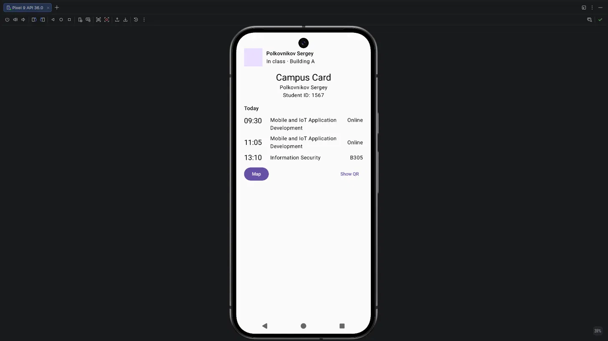
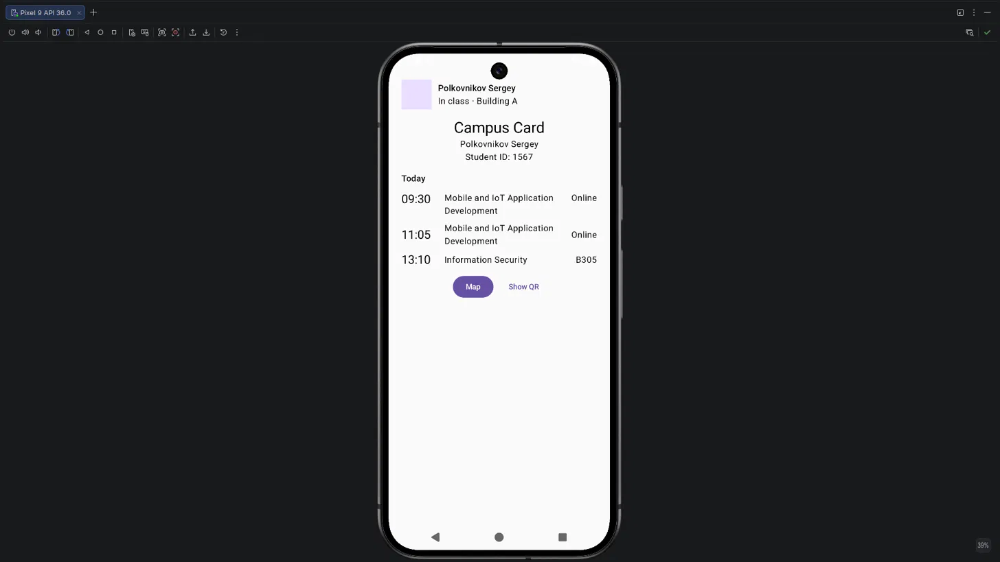

# Lab: Combining Rows and Columns

## Exercise 1

The title block is centered, the header and the schedule stay left-aligned.

## Exercise 2

*Image 1: SpaceBetween.*

*Image 2: Center.*

I keep SpaceBetween because it matches the schedule layout (left and right edges).

## Exercise 3

Top and CenterVertically differ only when a neighbor is taller than the time, for example a title wrapped to two lines.

## Exercise 6

The header goes to the top, the action row to the bottom, and everything else spreads out with large gaps. It is worse for a campus card, because related content ends up far apart.
